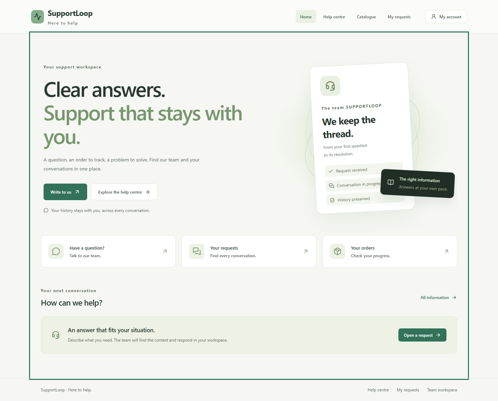
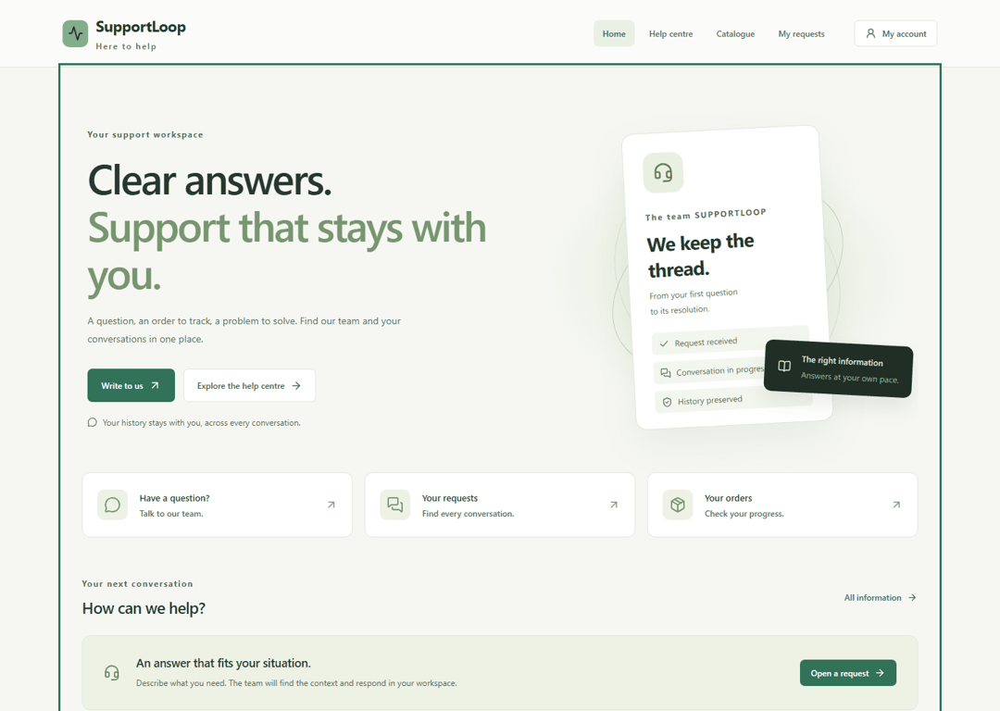
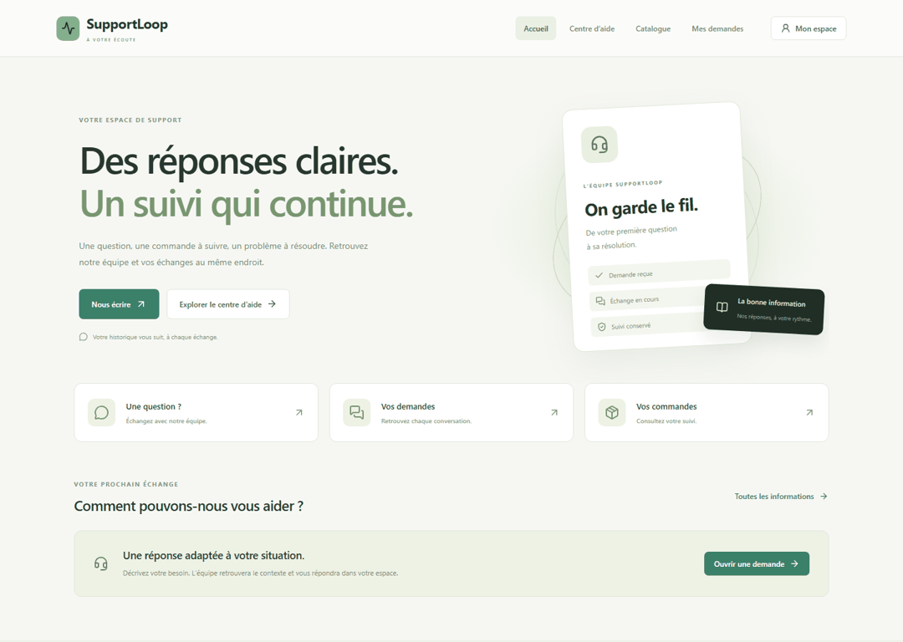
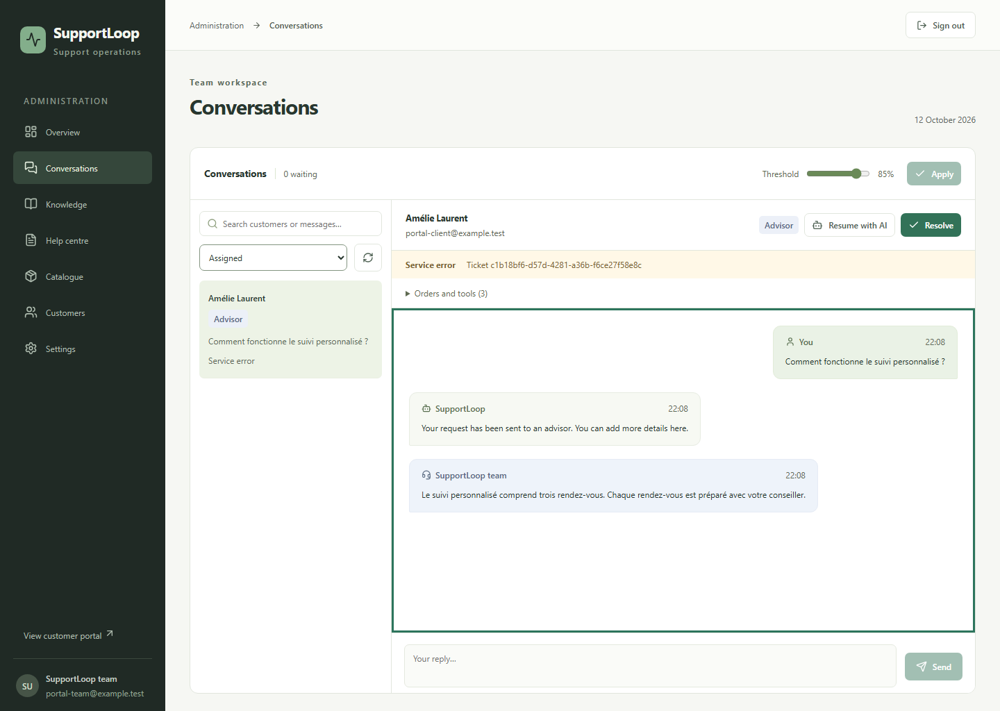
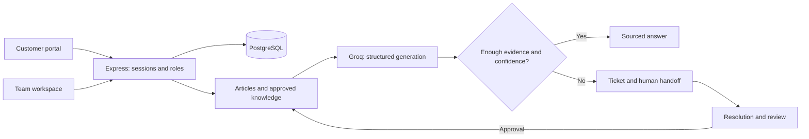

<div align="center">


# SupportLoop

**Clear answers. Support that stays with you.**

A customer portal and a team workspace, with an optional AI assistant grounded in your data and knowledge reviewed by your team.

[](https://github.com/toaandri/support-loop/actions/workflows/ci.yml)


[Get started](#get-started) · [Features](#one-service-two-workspaces) · [Learning loop](#how-the-assistant-learns) · [French documentation](README.fr.md)



</div>

Publish your own help articles, products and services. Customers create an account and follow their private requests; the team handles conversations and reviews reusable knowledge. PostgreSQL persists accounts, sessions, requests, orders and approved knowledge across restarts.

The interface and main documentation are in **English**. Customer messages and your published content retain their original language. Currency remains EUR.

## Get started

Requirements: **Node.js 22.16+**, npm and **Docker** for PostgreSQL.

1. Copy `.env.example` to `.env`.
2. Set `ADMIN_EMAIL` and a unique `ADMIN_PASSWORD` of **12–128 characters**.
3. Optionally add `GROQ_API_KEY` from [Groq](https://console.groq.com/keys). Accounts, help articles and human support work without it.
4. Run from the repository root:

```bash
npm run setup
docker compose up -d postgres
npm run dev
```

| URL | Workspace |
| --- | --- |
| [localhost:5173](http://localhost:5173) | Customer portal, help, catalog, requests and orders |
| [localhost:5173/admin](http://localhost:5173/admin) | Team sign-in using the configured administrator credentials |
| [localhost:3000/api/health](http://localhost:3000/api/health) | API health |

If port 5173 is busy, set `FRONTEND_PORT=5174`; the launcher prints the selected address. Schema setup is idempotent. A fresh database contains **no fabricated store or orders**. The initial administrator is created at startup; later starts do not overwrite their password.

Publish useful articles through **Help centre** and add products or services through **Catalogue** in the administration. Customers register through **My account → Create an account**. Test the optional Groq connection in **Settings**.

To run the compiled stack with Nginx:

```bash
docker compose up -d --build
```

Ports bind to localhost. PostgreSQL volumes preserve data. `.env` is private and ignored by Git; provider keys stay on the server.

## One service, two workspaces

| Customers | Support team |
| --- | --- |
| Registration, sign-in and sign-out | Authenticated administrator role |
| Public help articles and search | Publish, edit and withdraw articles |
| Catalog, prices and availability | Maintain products and services |
| Private requests, history and statuses | Queue, search, context, assignment and replies |
| Account-specific orders | Customer details, related orders and tool traces |
| Automatically refreshed human replies | Review, edit, approve and withdraw knowledge |
| Responsive mobile layouts | Event-based statistics and handoff settings |



Sessions use `HttpOnly`, `SameSite=Strict` cookies with a seven-day lifetime. Passwords are hashed with scrypt. Customer identity comes from the session; supplying a different customer ID never grants access to that customer's conversations or orders. Team actions also validate the acting identity.

## How the assistant learns

**Question → verified sources → answer or human handoff → resolution → proposed rule → review → reuse.**



These recordings use the actual application and an isolated test database, without a Groq key. The workflow shows human handling and a manually written rule. With a configured provider, Groq can propose a rule when a request is resolved; publication still requires the team's approval. Names and example content in a recording are test data and may be in French.

1. The server searches help articles and approved knowledge, and retrieves relevant business data for the signed-in customer.
2. Groq drafts a response from those facts with documentary citations.
3. Sensitive actions, a request for a person, insufficient evidence, low confidence or provider failure trigger a ticket and human handoff with history.
4. Resolution produces a reviewable proposal that retains its correction and provenance.
5. The team verifies the topic, condition and general answer. In Groq mode, only the **general rule** enters the index, without copying the private correction.
6. Approved rules become available for later searches and can be withdrawn.

This enriches a **knowledge base**; it does not train model weights. The default provider is Groq with `openai/gpt-oss-20b`. You supply your own key, and [provider quotas](https://console.groq.com/docs/rate-limits) apply. In Groq mode, an absent key or provider outage transfers requests to a person; generated responses are never simulated. PostgreSQL full-text search is currently tuned primarily for French content. Confidence is an estimate, not a factual guarantee.



## Architecture



```text
backend/          API, authentication, providers, business rules and tests
frontend/         Customer portal, team workspace and local assets
database/         Idempotent schemas and separate fixtures
knowledge/        Documents for ingestion; isolated demo examples
scripts/          Startup, browser checks, media capture and backups
docs/             API, architecture, operations and security guides
n8n/workflows/    Optional adapters requiring explicit credentials
```

## Verify the project

```bash
npm run check       # Backend tests and React production build
npm run evaluate    # Deterministic offline scenarios and before/after comparison
```

PostgreSQL integration tests require a **dedicated test database** and `TEST_DATABASE_URL`. Tests that lack this connection are explicitly skipped. Install the browser tooling before running UI checks:

```bash
python -m pip install -r scripts/media-requirements.txt
python -m playwright install chromium
npm run test:portal
npm run test:e2e
npm run docs:media
```

The portal check requires `TEST_DATABASE_URL` and uses a disposable `supportloop_portal_test` database on ports 3102/5181. To isolate simultaneous runs, set `PORTAL_TEST_DATABASE_NAME` to `supportloop_portal_test_<unique_suffix>`. Never point test commands at production data. It verifies accounts, access control, published help, catalog, orders, human conversation, knowledge review, persistence and mobile layouts. Provider integration tests intercept external inference while checking retrieval and activation against PostgreSQL. Live inference still requires your own key and provider validation.

An optional `AXE_CORE_PATH` enables automated accessibility checks during portal capture. Automated checks supplement keyboard and visual review; they are not a certification.

## Optional modes and current limits

Defaults: `AGENT_MODE=groq`, `STORAGE_MODE=postgres`, `AUTH_MODE=session`, `DEMO_MODE=false`. A legacy in-memory fixture mode is available with `AUTH_MODE=keys`, `AGENT_MODE=demo`, `STORAGE_MODE=memory`, `DEMO_MODE=true`; older demo media documents that deterministic engine.

`AGENT_MODE=rag` enables optional OpenAI/pgvector integration, requiring a key and potentially paid calls. n8n adapters also require explicitly configured service credentials and channel destinations.

Orders are read from PostgreSQL and scoped to their customer. ERP/store integration belongs in repositories; payments, automatic refunds and live email/WhatsApp delivery are not presented as connected. This release serves one support organization.

## Further documentation

The detailed guides are currently in French; the main GitHub presentation and interface are English.

| Guide | Contents |
| --- | --- |
| [Project status](docs/status.md) | Delivered behavior, checks and limits |
| [Architecture](docs/architecture.md) | Components, storage and flows |
| [API](docs/api.md) | Accounts, routes, payloads, roles and errors |
| [AI and retrieval](docs/rag.md) | Groq, full-text search, ingestion and optional OpenAI |
| [Learning loop](docs/learning-loop.md) | Proposals, review, publication and privacy |
| [Operations](docs/operations.md) | Local setup, Docker, backups and diagnostics |
| [Security](docs/security.md) | Sessions, identities, tools and provider data |
| [n8n](n8n/README.md) | Workflows, service access and channels |
