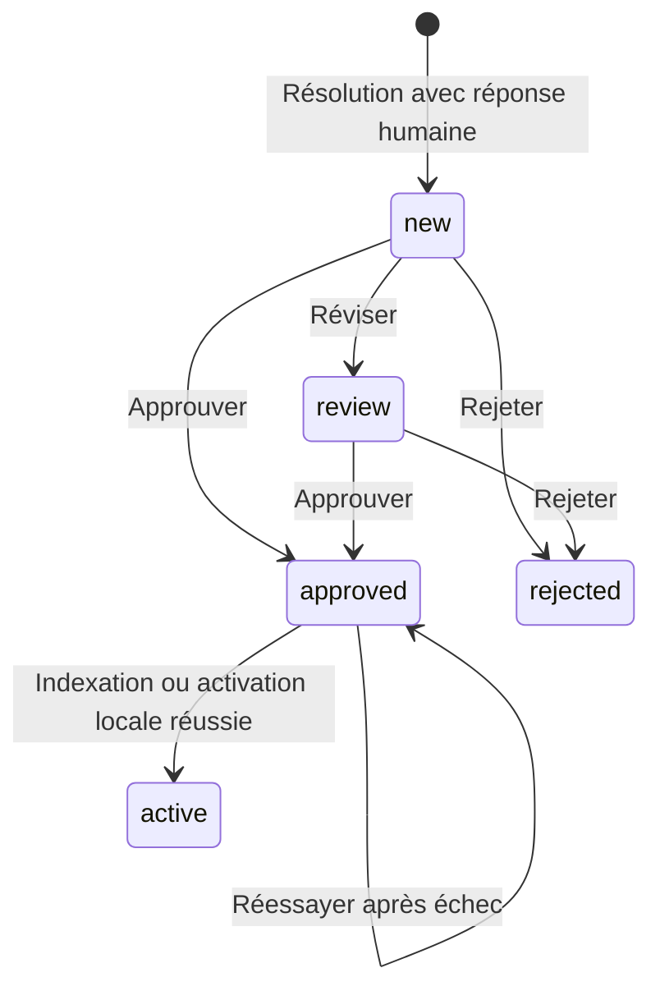

# Boucle d’apprentissage

La connaissance progresse grâce aux réponses humaines validées. Aucun modèle
n’est réentraîné automatiquement et aucune réponse humaine n’est activée sans revue.

## Collecte

La résolution est sauvegardée dans une transaction avant la collecte. Le service
analyse le cycle courant de conversation, conserve la question, la réponse IA
initiale éventuelle et les réponses humaines. En mode RAG, OpenAI propose une
règle `{ intent, condition, resolution, notes }`. Si l’extraction échoue, la
réponse humaine reste disponible pour révision, sans règle. La démo collecte la
réponse sans modèle. Une résolution sans réponse humaine ne crée pas de connaissance.

La route `/support/conversations/:id/learn` permet une relance sur une conversation
résolue. Une proposition déjà présente pour le même dossier et la même réponse
humaine n’est pas dupliquée. La collecte attend la fin de son travail avant de
rendre la réponse de résolution ; une erreur est journalisée sans annuler le dossier.

## Révision

Dans Connaissances, les entrées sont recherchables et filtrables. Réviser marque
une nouvelle entrée `review`. Le conseiller peut corriger la réponse, écrire une
règle JSON, effacer cette règle avec `null`, approuver ou rejeter.

Une règle non nulle doit contenir des chaînes `intent`, `condition`, `resolution`.
`notes` est optionnel ou nul. Les entrées `approved`, `active` et `rejected` ne
peuvent plus être éditées via l’API. Cela empêche que le texte affiché d’une
connaissance active diverge silencieusement de ses chunks indexés.

## Activation

En RAG, l’approbation sauvegarde le réviseur et l’horodatage puis crée un embedding
et remplace `learned/<id>.md` dans pgvector. `active` n’est écrit qu’après succès.
Si l’indexation échoue, l’entrée reste `approved` et le bouton de relance permet
de réessayer. Le remplacement du même document est idempotent.

En démo, `active` signifie disponible dans la recherche locale. Le matcher
compare les mots significatifs de la question, exige au moins deux mots communs
et un recouvrement d’au moins 65 %. Cette recherche est lexicale et ne prétend
pas généraliser comme un embedding. Les propositions et les rejets sont exclus.

Si un provider est injecté sans knowledge store (par exemple dans les tests),
l’approbation reste `approved`. Le serveur RAG exige toujours PostgreSQL.

## Garde-fous et limites

La détection d’action sensible a priorité sur les connaissances actives. Une
réponse de garantie validée ne permet jamais un remboursement automatique.
Une règle est un contexte documentaire, pas une permission d’exécuter une action.
Le contexte spécifique à un client doit être retiré par le réviseur avant validation.

Les actions d’une même entrée sont sérialisées dans le processus backend fourni.
Pour plusieurs instances, ajouter un verrou distribué/transactionnel, ainsi qu’une
file persistante pour les extractions. La reprise manuelle `/learn` couvre les
échecs du périmètre actuel ; il n’y a pas de worker durable caché.

