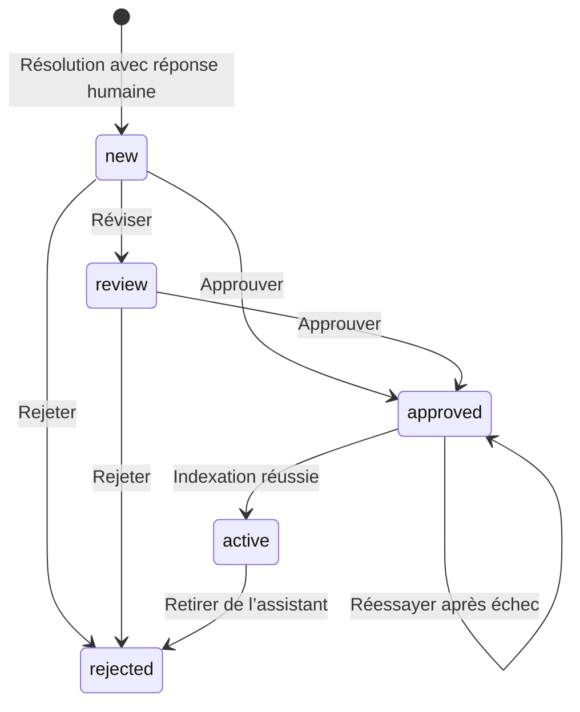

# Boucle d’apprentissage

La base progresse grâce aux règles validées par l’équipe. Le modèle n’est pas
réentraîné. Les corrections restent des propositions jusqu’à l’approbation.

## Collecte et révision

La résolution est sauvegardée avant l’extraction. Groq propose un sujet, une
condition, une réponse générale et des précisions facultatives à partir du cycle
courant de conversation. Si le fournisseur échoue ou si la correction concerne
uniquement ce dossier, la réponse humaine est conservée sans règle pour révision.
Une résolution sans réponse humaine ne crée pas de proposition.

L’équipe révise la provenance, corrige la réponse, puis rédige ou adapte la règle
avec les champs du formulaire. Une règle Groq est obligatoire avant approbation.
Elle doit conserver les conditions exactes et exclure les noms, emails, numéros
de commande et détails propres au client.

La route `/support/conversations/:id/learn` relance la collecte d’un dossier résolu.
La même correction dans le même dossier n’est pas dupliquée. Les propositions,
rejets et entrées encore en cours d’indexation ne sont jamais utilisés par l’IA.

## Activation et retrait

L’approbation sauvegarde le réviseur et la date puis remplace le document
`learned/<id>.md`. Groq indexe seulement la règle générale par plein texte ; la
question privée et la correction brute restent accessibles à l’équipe dans le
dossier de révision. `active` n’est enregistré qu’après réussite du remplacement.
Une panne laisse l’entrée `approved`, avec un bouton pour réessayer l’indexation.

Une connaissance validée est immuable. Le bouton **Retirer de l’assistant** enlève
le document de l’index et marque l’entrée rejetée. Les prochaines recherches ne
la retrouvent plus ; les anciens messages restent dans leur historique.

Les actions sensibles restent transférées malgré une connaissance pertinente.
Une règle fournit un contexte, sans permission d’effectuer un paiement ou un remboursement.

## Variantes et limites

OpenAI RAG crée un embedding à l’activation. Le mode démo utilise une correspondance
lexicale des questions et des réponses fictives. Ces variantes sont séparées du
portail Groq et ont leurs tests de régression.

Les opérations sur une connaissance sont sérialisées localement. Plusieurs
instances nécessiteraient un verrou distribué et une file persistante d’extractions.
Le mode fourni conserve la correction en cas d’échec et permet une reprise manuelle.

Le GIF utilise une base de test et aucune clé Groq. La règle y est rédigée par le
conseiller ; la proposition automatique nécessite la clé du fournisseur.
